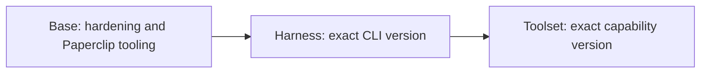

# Paperclip sandbox images

Infrastructure for building and publishing sandbox images for [Paperclip](https://github.com/paperclipai/paperclip). Images form explicit dependency chains:



The active catalog is intentionally empty. This foundation contains **no Dockerfiles or runnable images**. CI checks the repository now; image builds, runtime tests, and publication activate when recipes are registered.

## Layout

| Location | Purpose |
| --- | --- |
| `catalog/` | Active image definitions and JSON Schema |
| `images/base/` | Future shared runtime and hardening recipes |
| `images/harnesses/` | Future agent CLI recipes |
| `images/toolsets/` | Future capability recipes layered onto harnesses |
| `src/` | TypeScript validation, dependency planning, building, testing, and promotion |
| `scripts/` | Runtime contract and checksum-pinned CI tools |
| `tests/` | Infrastructure tests and illustrative catalog metadata |
| `.github/workflows/images.yml` | Change-triggered, manual, and weekly pipelines |

## Development

Use Node.js 24 and the pnpm version in `package.json`:

```sh
corepack enable
pnpm install --frozen-lockfile
pnpm check
pnpm images plan --select all
```

`pnpm check` runs type checking, linting, unit tests, and catalog validation. For workflow/recipe linting on Linux:

```sh
node scripts/install-tools.ts checks
export PATH="$PWD/out/tools:$PATH"
actionlint
pnpm images lint-recipes
```

## Publishing

Relevant pushes to `main` rebuild affected entries and all descendants. Pull requests build and test without publishing. Every active version is rebuilt weekly on Monday at 03:23 UTC; manual dispatch accepts catalog IDs or `all`.

Both AMD64 and ARM64 must pass runtime checks and scans before publication. The pipeline promotes tested OCI artifacts to `ghcr.io/everlastingcrown`, signs them, and attaches SBOMs and provenance before moving version aliases and `latest`.

Tags identify the primary capability, with harness versions included for toolsets. `latest` selects the highest stable capability version, then the highest stable harness version. Older-version rebuilds cannot move `latest`. Use immutable build tags or digests for reproducibility.

See [image authoring](docs/images.md), [releases and recovery](docs/releases.md), and [the validation contract](docs/validation.md).

## GitHub setup

Enable Actions with package publishing allowed. The default GHCR namespace uses `GITHUB_TOKEN` and keyless OIDC. Set the `IMAGE_REGISTRY` repository variable to override the GHCR owner/path, and grant this repository write access there.

Make published parent packages publicly readable for unauthenticated fork PR builds. GHCR packages may initially be private; configure visibility and repository access after their first release. Install/enable Renovate separately; `renovate.json` supplies its configuration.

Protect `main` with Repository checks and, once images exist, both architecture candidate jobs. Real image and registry integration remain unverified until recipes are added and the workflow runs.
