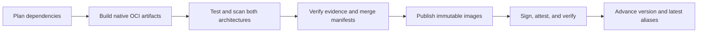

# Releases and recovery

## Tags

| Image   | Version alias                               | `latest` selection                             |
| ------- | ------------------------------------------- | ---------------------------------------------- |
| Base    | `sandbox-base:1.0.0`                        | Highest stable contract release                |
| Harness | `sandbox-codex:0.114.0`                     | Highest stable harness release                 |
| Toolset | `sandbox-python-codex:3.13.2-codex-0.114.0` | Highest stable capability, then stable harness |

Immutable build tags append `-sha-<12-character-SHA>-<run-ID>-<attempt>`. Weekly rebuilds produce distinct tags even with unchanged source versions. GHCR does not enforce immutability; repository permissions protect these tags, and operators must not overwrite them.

Prerelease capabilities and toolsets on prerelease harnesses cannot own `latest`. Ordering is numeric SemVer: `0.114.0` outranks `0.99.0`. No major/minor aliases are generated. Use immutable tags or digests for reproducibility.

## Release flow

All candidate jobs must pass before publication. Promotion validates referenced OCI blobs and hashes of scan reports/SBOMs. Skopeo uses `--preserve-digests`; registry conversion fails publication. No images are rebuilt during promotion.

BuildKit provenance stays in the OCI artifacts. The release signs the combined index, attaches architecture SBOMs and release provenance, and records source/build IDs, versions, parents, and per-platform identities in release metadata.

Trusted workflows are serialized. A stale checkout cannot publish over current `main`. Weekly builds refresh inputs without layer caching.

Pushes to `main` select affected images and their descendants by comparing against the latest successful main push or scheduled run of the Images workflow. This carries unpublished changes from failed releases into the next plan. Successful manual runs are excluded because their selection may cover only part of the catalog. The workflow searches earlier pages of successful runs when needed and excludes its own run when rerun.

If no eligible baseline exists, or its commit is missing or no longer an ancestor of the checkout, the push rebuilds the full catalog. API failures stop planning. The plan job needs `actions: read` to query run history. Weekly rebuilds still select all images, pull requests compare against their PR base, and manual dispatches honor the requested selection. A successful push with no affected images can advance the baseline because all image inputs still match the preceding successful release.

## Failure recovery

- Build, runtime, scanner, and missing-evidence failures prevent publication.
- Signing failures may leave immutable tags uploaded, but no movable aliases advance until every image is signed and verified.
- Registry updates across tags/repositories are not atomic. Alias-copy failure can leave partial advancement. Use the immutable references in release metadata for a consistent family.
- Rerun a failed workflow only while its source matches `main`; otherwise dispatch `all` on current `main` to include unpublished parent fixes, or let the next main push plan from the last successful automatic release. Select individual IDs only when their unchanged parents are already published. Never replace an immutable tag with different bytes.
- Roll consumers back to a previous verified digest. Automatic alias rollback and registry deletion are not performed.

Plans are retained for 14 days, candidates/failed reports for 7 days, and release metadata for 90 days. Preserve metadata externally for longer retention. Retired entries stop receiving updates; historical registry cleanup is separate.
